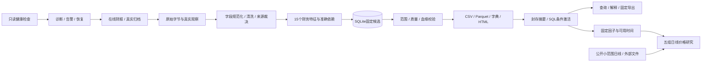

# 当前架构与维护入口

本文对应0.1.6实际实现，更新于2026-10-14。完整链路包括财报采集、规范化、清洗、版本存储、财务特征、查询、质量、恢复和可执行交付；另有简单日线分组研究。真实执行证据与限制见[交付记录](delivery_validation.md)，逐条题目对应见[要求对照](requirements_traceability.md)。

日常入口为根目录`config.py`、`main.py`和`run.cmd`：五项简单配置通过`RunConfig`复用原配置校验，自动补齐上一年历史；`runner.py`调用原`execute_online`同步生成15个因子，不维护第二条处理链。原14个命令、数据库表、质量、恢复和回测能力全部保留。当前只真实接入东方财富，未知来源不回退；导入入口不联网。

BacktestConfig提供可选回测开关、因子列表与交易区间/分组/持有期/费用；财报成功后固定返回快照，多因子共用一次行情采集与读取。回测未完成时保留财报并返回非零码。

## 业务链路

所有IO由入口与编排协调。纯清洗、金融公式和分组计算不访问网络、文件或数据库。财务输入是合并利润表、资产负债表和主要指标；输出包含真实有值特征以及保留原因的NULL，不用补零制造覆盖。

## 模块职责

| 位置 | 具体职责 |
| --- | --- |
| 根目录`config.py`、`main.py`、`run.cmd`，`runner.py` | 日常配置、直接run调用、中文摘要、同一流水线与Windows双击入口 |
| `cli.py`、`config.py` | 统一命令、参数与配置校验、绝对工作区、退出码 |
| `catalog.py`、`models.py`、`timeutil.py` | 字段与单位、业务对象、准确季度及时间边界 |
| `ingestion/client.py`、`archive.py`、`universe.py` | 串行请求、限流与重试、分页契约、正文摘要、冻结公司池 |
| `transforms/cleaning.py` | 纯类型/单位转换、字段状态、NULL原因及金融口径证据 |
| `features/factors/*/factor.py`、`registry.py`、`common.py`、`specifications.py`、`calculation.py` | 独立因子规格/公式、显式登记、共用金融运算、字典及准确依赖计算 |
| `source_records.py`、`storage/database.py` | 来源版本与观察、最新裁决、SQLite约束、版本保存与固定查询 |
| `pipeline.py`、`publication.py` | 冻结计划、处理与增量、门禁、发布和中断恢复 |
| `quality.py`、`reconciliation.py` | 覆盖/空值/异常/基线、同源勾稽、独立参考核对 |
| `monitoring.py`、`ops.py`、`runtime.py` | 告警与恢复、独立只读诊断、备份、OS写锁 |
| `exports.py` | 固定快照的CSV/Parquet、字典、质量和HTML；回读与摘要校验 |
| `backtest/calculation.py`、`io.py`、`batch.py`、`report.py`、`market.py`、`sample.py` | 纯五组计算、时间投影及读写、中文报告与图表、公开日线、明确人工样例 |

这些模块按实际变更原因分开，没有任务平台、插件注册器、通用Repository或公式解释器。当前小样本每个数据集一份Parquet，不按公司和季度生成大量小文件。Windows使用PyInstaller目录包，整个EXE及依赖目录一起交付；源码使用同一CLI。

## SQLite为何保留25张表

SQLite是业务版本及发布事实的唯一权威。原始HTTP正文保存在不可变文件中；CSV、Parquet、HTML及publication receipt均为固定或可修复的派生产物。DDL位于`src/finpipe/resources/migrations/001_initial.sql`；三张`clean_*`宽表由字段规格建表。

| 表组 | 数量 | 实际职责 |
| --- | --- | --- |
| `schema_version`、`processing_profiles`、`universe_snapshots`、`scopes`、`expected_keys` | 5 | 数据结构、处理口径、公司池、期间范围和带资格证据的请求全集 |
| `runs`、`batches`、`http_attempts`、`run_inputs` | 4 | 冻结运行、采集计划、请求尝试与本次实际输入 |
| `source_versions`、`source_observations`、`clean_versions`、三张`clean_*`、`record_states` | 7 | 内容版本、真实抓取事件、清洗宽表和最新来源裁决 |
| `feature_versions`、`feature_inputs` | 2 | 特征值/状态及包括未满足依赖的精确输入 |
| `quality_events`、`quality_metrics`、`alerts` | 3 | 问题证据、统计基线、告警确认与恢复状态 |
| `dataset_snapshots`、`snapshot_records`、`snapshot_features`、`workspace_head` | 4 | 固定发布、精确消费成员及每个scope的当前发布头 |

`source_pages`是成功归档尝试的视图，不再存一套HTTP事实。5个显式索引用于来源业务键、最新状态、特征目标、输入反查和发布历史；复合主键与唯一约束还产生SQLite内部索引。

内容相同的重复观察可以复用源版本，但不能伪造或覆盖真实抓取事件。最新裁决可能是冲突、缺失或坏新版，须保留新状态并使依赖产生NULL；不能先过滤坏值再找到旧好值。快照同时固定财务成员及特征成员，保证因子解释用到的clean/state与实际发布一致。

## 增量、发布与恢复

首次扫描完整输入范围；`run --refresh recent`随后扫描最近4季度，发布仍覆盖原冻结输出范围。变更按公司和有限准确期间重算，其他目标复用已有精确版本；同数值但状态或血缘改变仍可生成新版本。profile改变会重算，旧冻结运行恢复时使用原口径。

候选先事务保存为PREPARED，然后导出回读、封存摘要、同盘改名，最后在短SQL事务中校验预期父head并激活。仅有目录不代表已发布；旧候选不能覆盖新head。SQL激活后缺receipt时只补派生回执和运行结果，不更改实际发布时间。

写操作使用单工作区OS排他锁，网络请求在SQL事务之外。health使用只读数据库连接并写独立诊断；后续持锁运行幂等补入。告警确认仅代表已看到，恢复需新的覆盖扫描、规则复查及下游恢复。backup使用SQLite一致备份接口，并复制引用原文与固定产物后核验。具体命令见[运行维护说明](implementation.md)。

## 时间与金融边界

报告期、公告/已知更新日期、真实观察、处理及实际发布分别保留。准确同年相邻累计期用于单季差分，同比使用准确lag4；已知重述风险未证明可比时，相关差分和跨期变化停止并保留原因。单期值及同期比率可按各自输入状态展示，金融公式和单位见[数据契约](data_contract.md)。

当前公开历史财报可能包含后来更正值，尚不能证明完整历史PIT。回测默认按本系统实际数据可用与发布边界使用信号；显式`publication_proxy`按所有依赖的公告及已知更新边界近似放出，同时保留真实观察/发布时间并披露历史版本未核验。该投影不修改财务库或原始证据。

分组研究使用下一交易日收盘入场、非重叠持有窗口、五组等权收益。缺端点价格使相关组收益与后续累计净值为NULL，不删坏股票或前填价格。公开后复权报价尚未逐项核验分红及股份变动，不额外加分红现金流；停牌、涨跌停和成交限制也未模拟。盘中真实协议、序号与补包系统不在当前实现范围。具体定义与复算命令见[回测说明](backtest.md)。

## 修改时从哪里开始

| 维护任务 | 应修改的入口与核验 |
| --- | --- |
| 新字段或来源字段变更 | `catalog.py`的FieldSpec及源字段规格；核验单位、期间、映射、字典与Arrow类型 |
| 清洗阈值或规则变化 | `transforms/cleaning.py`及`config.py`/TOML的规则参数；新运行生成新profile，保留旧版结果 |
| 新财务因子 | `features/factors/<名称>/factor.py`统一维护公式/单位/准确依赖，registry.py登记；口径升级更新公式版本、冻结恢复与完整网格测试，见[factors.md](factors.md) |
| 质量指标或门禁 | `quality.py`及对应配置；明确分子分母、缺值含义与局部失效/全局阻断，核验告警与恢复 |
| 来源接入或响应结构变化 | `ingestion`契约校验和字段规格；保留失败原文，修正规格后以新profile重放 |
| 回测输入或研究口径 | `backtest`对应计算/IO/行情模块；保留真实时间和输入SHA，避免在回测重复实现财务公式 |
| 数据库结构 | 新的明确迁移及备份/恢复验证；不靠删库重建处理未知结构 |

所有人工代码注释和docstring使用中文。测试重点是金融手算、最新坏版失效、准确季度、增量等价、发布恢复及回测时间边界；常规回归不依赖公网。增加抽象前先确认已有重复维护问题，不为可能出现的新资产或规模预建平台。
